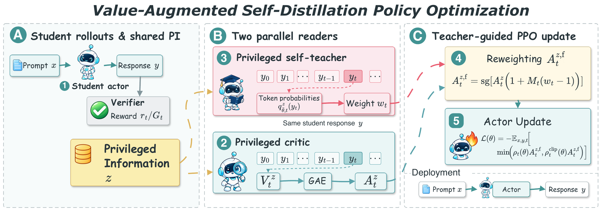
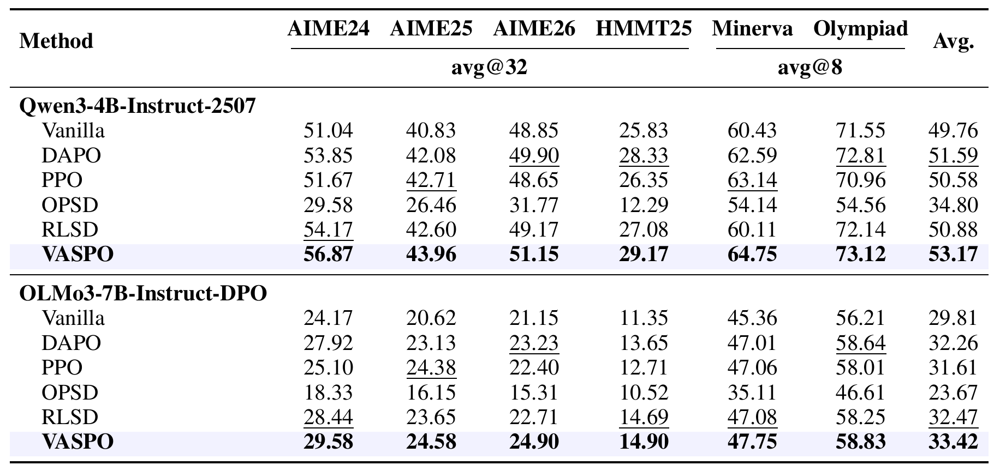
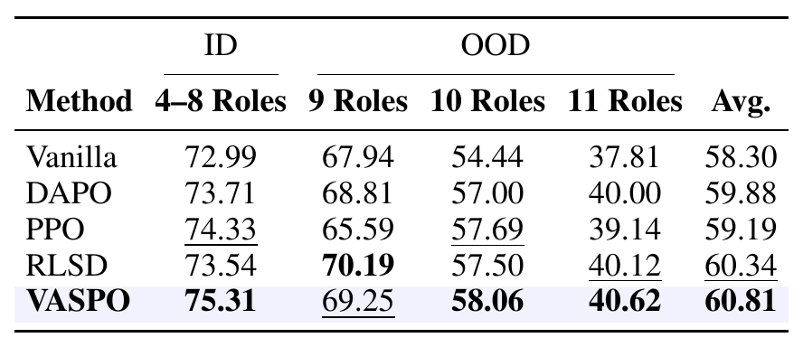
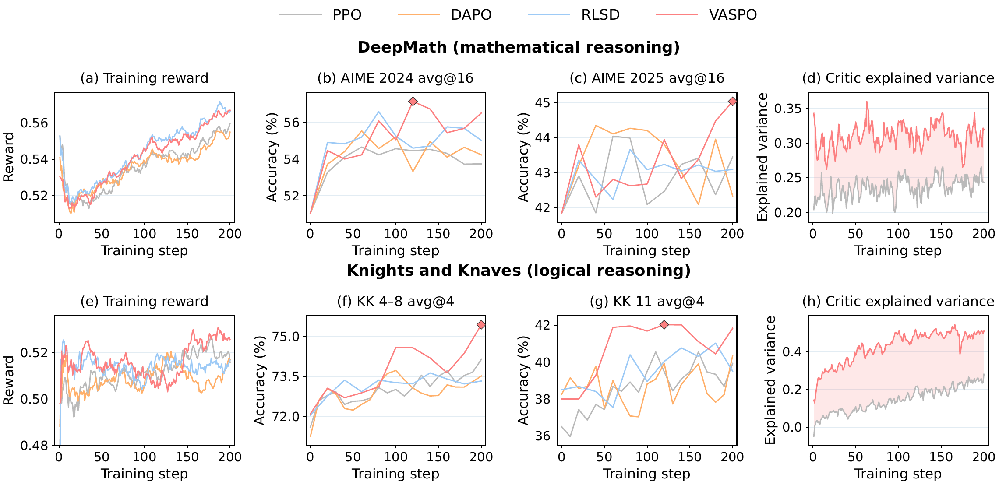

# VASPO

Research implementation of **VASPO: Self-Distillation with Privileged Value Estimation**,
prepared from the paper's submission source. VASPO combines privileged teacher
signals with value-based advantages for policy optimization.

The training stack builds on a modified `verl` implementation. Upstream
copyright notices, the Apache-2.0 license, and `Notice.txt` are preserved.
See [source provenance and scope](docs/SOURCE.md) for what this repository contains
and which reproduction assets still need to be supplied.

## Overview



The critic and self-teacher read the same reference solution and answer at
student-generated prefixes. The critic supplies GAE advantages, and the teacher
modulates selected positive advantages with bounded probability-ratio weights.
The actor uses only the original prompt during rollout and deployment.

## Main results

### Mathematical reasoning



Accuracy (%): avg@32 on AIME24, AIME25, AIME26, and HMMT25; avg@8 on
Minerva Math and OlympiadBench. The average weights the six benchmarks equally.
Bold and underlined scores mark the best and second-best results per backbone.

### Knights and Knaves



Accuracy (avg@16, %) on Qwen3-4B-Instruct-2507. The 4-8-role group is
in-domain; the 9-, 10-, and 11-role groups test out-of-distribution transfer.
The average weights the four groups equally.

## Training dynamics



Top: DeepMath training reward, AIME 2024/2025 avg@16 accuracy, and critic
explained variance. Bottom: KK training reward, 4-8-role and 11-role avg@4
accuracy, and critic explained variance. These training-time curves use the
sampling counts shown in the panels; the main result tables use the counts
listed above. Images are exported from the paper; see [asset sources](assets/paper/README.md).

## Repository layout

```text
rlcsd/                  Privileged context, teacher integration, and diagnostics
critic_init/            Offline critic pretraining, data conversion, and ZeRO-1 config
verl/                   Modified training framework, workers, and Hydra configs
scripts_run/            Model/task examples and shared VASPO launcher
scripts/run_vaspo.sh     Compatibility entry point for Qwen3 mathematics
scripts/                Source audit and deterministic archive tools
tests/                  CPU math, launcher/configuration, and packaging checks
docs/                   Source notes and historical submission validation records
assets/paper/           Paper overview, result tables, and training curves
```

## Implementation

- `verl/trainer/ppo/core_algos.py`: detached teacher gap, tanh token gate,
  clipped probability-ratio weights, and response-mean clipped PPO.
- `rlcsd/self_distill_main.py`: teacher context, scoring cache, driver fusion,
  and configuration validation. The package name is retained because it also
  contains the existing OPSD/RLSD/RLCSD baseline interfaces.
- `verl/trainer/ppo/ray_trainer.py`: critic pre-update, refreshed values/GAE,
  actor update, and rollout importance correction.
- `verl/workers/actor/dp_actor.py`: teacher forward, EMA updates, and the
  optional current-policy denominator / teacher-rescoring paths.
- `rlcsd/vaspo_metrics.py`: detached signal and position diagnostics.
- `scripts_run/_vaspo_launch.sh`: shared paper hyperparameters and training command.
- `scripts_run/*-vaspo-*.sh`: Qwen3/OLMo3 mathematics and Qwen3 KK examples.

VASPO computes `d = log q_teacher - log p_old`, selects valid tokens with
`A > 0` and `abs(tanh(d / tau)) > delta`, then uses
`A_fused = A * (1 + M * (clip(exp(d), 1-epsilon_w, 1+epsilon_w) - 1))`.
The implementation clips in log space before exponentiation to avoid overflow.
Selected and unselected PPO terms share the response's valid-token denominator.

The method identifier, configuration keys, batch tensors, hooks, and metric
prefixes use `vaspo`. Network `port` and `MASTER_PORT` names are unchanged.
Legacy `add`, `mul`, `mul_hybrid`, interpolation strength, alternative gap mask,
extra weight bounds, hybrid offsets, independent path normalization, branch
weights, and VASPO-specific DPPO clipping have been removed. Old method keys
are not supported. Generic upstream / baseline features are retained.

## Installation

Use Python 3.12 or newer. The inherited dependency files describe a GPU training
stack; they are not a lockfile of the original experiment environment.
Training requires a CUDA-capable Linux machine. Install the compatible
CUDA/PyTorch and vLLM stack on that machine, then run from the repository root:

```bash
git clone https://github.com/cii030/VASPO.git
cd VASPO
python3 -m venv .venv
source .venv/bin/activate
pip install -e '.[vllm,math]'
```

The distribution and import package names remain `verl` for compatibility with
the inherited framework; the VASPO integration also installs `rlcsd`.

## Data and training

Prepare the solution critic with the [critic-pretraining pipeline](critic_init/README.md),
then supply the actor, critic checkpoint, and training/validation Parquet files.
Set the paths before launching:

```bash
export MODEL_ROOT=/path/to/pretrained_models
export DATA_ROOT=/path/to/dataset
export OUTPUT_ROOT=/path/to/outputs
export CRITIC_MODEL_PATH=/path/to/pretrained_solution_critic
bash scripts_run/qwen3-4b-instruct-vaspo-math-deepmath.sh vaspo qwen3_math
```

See [launch examples](scripts_run/README.md) for the OLMo3 mathematics and
Qwen3 KK commands, expected data paths, parameter mapping, and overrides.
`scripts/run_vaspo.sh` forwards to the Qwen3 mathematics example.

Training Parquet rows must contain `prompt`, `reward_model.ground_truth` (final
answer), and `extra_info.solution` (reference derivation). A list of solutions
uses its first entry in both readers. Both readers receive this fixed evidence;
the rollout actor receives the original prompt. Solution-conditioned training
fails on missing solutions. The inherited critic validation path falls back to
answer-only context when validation solutions are incomplete.

The launcher defaults to 8 GPUs on one node, batch 128, PPO mini-batch 32,
8 responses per prompt, prompt/response limits 2048/8192, 200 rollout updates,
actor/critic learning rates 1e-6/5e-6, gamma=GAE lambda=1, PPO/weight clip widths
0.2, tau=delta=0.02, EMA decay 0.95, critic pre-update enabled, and no advantage
whitening, entropy penalty, or reference KL. Actor and critic use AdamW with
50-step warmup, then a constant learning rate, and weight decay 0.01.
Validation explicitly enables sampling. The solution critic prompt limit
defaults to 2048 and is configurable with `CRITIC_MAX_PROMPT_LENGTH`;
overlong inputs use the inherited strict truncation behavior.

Optional environment settings:

| Setting | Default | Use |
|---|---|---|
| `VASPO_EPSILON_W` | `0.2` | Weight-clip ablation (`0`, `0.2`, `0.5`) |
| `VASPO_USE_TOKEN_MASK` | `true` | Disable the gap mask; retain the positive-advantage gate |
| `PRIVILEGED_TEXT_MODE` | `solution_answer` | `answer_only` disables solution context in both readers |
| `PRE_UPDATE_VALUE_BEFORE_ADV` | `true` | Critic schedule ablation |
| `NORMALIZE_ADVANTAGES` | `false` | Global post-fusion whitening; requires cached teacher and old denominator |
| `VASPO_STUDENT_PROB_SOURCE` | `old` | Appendix variant: `current` |
| `VASPO_TEACHER_IN_ACTOR_UPDATE` | `false` | Appendix variant: rescore teacher inside actor updates |
| `MODEL_PATH`, `TRAIN_FILES`, `VAL_FILES` | Qwen3 math paths | Supply another model / task's assets |
| `VAL_N` | `32` for math, `16` for KK | Use `8` for Minerva Math / OlympiadBench validation |
| `CRITIC_MAX_PROMPT_LENGTH` | `2048` | Runtime privileged-reader prompt budget; fit the complete evidence |
| `VASPO_DIAGNOSTICS`, `VASPO_POSITION_LOG` | `false`, `null` | Optional diagnostics |

The repository includes offline critic data conversion and pretraining under
`critic_init/`. Sample and verify the initial actor's trajectories before running
its converter. Benchmark evaluation scripts, full datasets, trained weights,
and exact historical run configurations must still be supplied to
reproduce the reported results. This launcher aligns the visible paper settings;
it does not verify that the historical experiments used them. The examples use
the full supplied training file without a sample cap or dynamic group filtering.
The critic uses the inherited separately optimized clipped value loss with its
built-in factor of 0.5; no new joint actor/value coefficient is introduced.

## Acknowledgements

We thank the developers and contributors of [verl](https://github.com/volcengine/verl)
and [RLCSD](https://github.com/THU-BPM/RLCSD) for open-sourcing their code.
This implementation builds on their training framework and self-distillation code.

## License

See [LICENSE](LICENSE) and [Notice.txt](Notice.txt) for the inherited Apache-2.0
license and attribution. Existing source copyright headers are retained.
