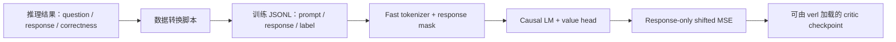

# Critic Value Model 预训练

本目录用于在 PPO/verl 训练之前初始化一个 token-level critic（value model）。训练数据由“问题 + 模型回答 + 回答是否正确”组成；模型读取完整上下文，但 loss 只作用于 assistant response 对应的 action/value 位置。

训练目标不是生成文本，也不是 pairwise reward modeling。它学习的是：给定问题和当前回答前缀，这条回答最终正确的概率有多大。

## VASPO 快速开始

该目录从作者的 critic 预训练代码迁入。Python 训练和数据转换实现保持原样；
启动脚本已移除集群绝对路径，并提供仓库内的 `configs/zero1.json`。
以下命令从 VASPO 仓库根目录执行，完整 GPU 训练需要 CUDA、FlashAttention 2 和匹配的模型环境。

```bash
pip install -r critic_init/requirements.txt
export MODEL_PATH=/path/to/Qwen3-4B-Instruct-2507
export OUTPUT_DIR=/path/to/qwen3_math_solution_critic

# 输入为初始 actor 生成、任务 verifier 已打分的轨迹。
python critic_init/scripts/convert_infer_to_critic_jsonl.py \
  --mode solution \
  --multi_solution_mode first \
  --input_file /path/to/scored_initial_actor_rollouts.jsonl \
  --reference_file /path/to/reference_solutions.jsonl \
  --model_name_or_path "$MODEL_PATH" \
  --all_correct_downsample_factor 1 \
  --balance upsample \
  --output_file /path/to/solution_critic_train.jsonl

TRAIN_FILE=/path/to/solution_critic_train.jsonl \
  bash critic_init/scripts/train.sh

# 用预训练产物初始化 VASPO 的 privileged critic。
export DATA_ROOT=/path/to/dataset
export OUTPUT_ROOT=/path/to/rl_outputs
CRITIC_MODEL_PATH="$OUTPUT_DIR" \
  bash scripts_run/qwen3-4b-instruct-vaspo-math-deepmath.sh vaspo qwen3_math
```

论文中，初始 actor 在标准 prompt 上为每题采样 8 条回答，任务 verifier 提供二元标签。
这些已打分轨迹是转换器的输入；转换器不生成回答或计算正确性。
`--mode solution` 将同一数据集中的第一个参考解和答案加入 critic 上下文。
raw / answer 对照分别使用 `--mode raw` / `--mode answer`，其余轨迹和标签保持一致。

上面的论文示例显式关闭全对题下采样，并启用平衡上采样；转换器原有的默认下采样因子仍为 4，
通用行为见第 6.4 节。上采样针对全局少数标签；当错误轨迹较少时，即上采样错误轨迹。
更换为 OLMo3 或 KK 时，使用对应 backbone 的初始轨迹、tokenizer、参考解和输出目录。
输入示例只用于说明格式，不是论文中的完整预训练数据。

## 1. 核心行为

每条样本包含：

- `prompt`：经过 tokenizer chat template 渲染的完整对话，包含 user question 和 assistant response；
- `response`：assistant 的原始回答文本，用来定位 response token；
- `label`：序列级二分类标签，正确为 `1.0`，错误为 `0.0`。

训练时：

1. 完整的 question + response 进入 causal model；
2. 使用 fast tokenizer 的字符 offset 找到 response token；
3. question、system prompt、padding 的 `response_mask` 为 0；
4. response 正文 token 的 `response_mask` 为 1；
5. 1 维 value head 的输出经过 sigmoid 转成 `[0,1]` 概率；
6. 同一个序列级标签广播到所有 response action；
7. 仅在 response action 上计算 MSE；
8. 在正常训练日志中同步输出 response-action explained variance。
9. 默认全参数训练；可通过开关冻结 backbone，只训练 value head。



需要特别区分两个 mask：

- `attention_mask`：控制模型前向时哪些 token 是有效输入。question 和 response 都是有效输入，因此 response 可以关注 question；
- `response_mask`：控制哪些 action/value 位置进入 loss。question 不获得独立监督，padding 也不进入 loss。

因此，“忽略 question”仅指不在 question action 上直接计算 loss，不是把 question 从模型上下文中删除。

## 2. 与 verl critic 的 token 对齐

设完整序列为：

```text
[question tokens] [response token 1] [response token 2] ... [response token R]
```

causal critic 在位置 `t - 1` 产生的 value 用于监督位置 `t` 的 response action。代码中对应：

```python
shifted_preds = preds[:, :-1]
shifted_labels = labels[:, 1:]
shifted_response_mask = response_mask[:, 1:]
```

这与 verl 中下面的截取方式一致：

```python
values = values[:, -response_length - 1 : -1]
```

直观上：

```text
最后一个 question token 的 value  -> response token 1
response token 1 的 value          -> response token 2
...
response token R-1 的 value        -> response token R
```

在 MSE 模式下，令 `y_i ∈ {0,1}` 是第 `i` 条回答的正确性标签，`v_{i,t}` 是 value head 在位置 `t` 的原始输出，`m_{i,t}` 是 response mask，则实际 loss 为：

```text
p_{i,t-1} = sigmoid(v_{i,t-1})

L = sum_{i,t} m_{i,t} (p_{i,t-1} - y_i)^2
    ------------------------------------------------
                     sum_{i,t} m_{i,t}
```

这里最后一个 question token 虽然提供第一个 response action 的 value，但 question-only 位置不会被当作独立训练目标。

## 3. 目录结构

```text
critic_init/
├── README.md
├── configs/
│   └── zero1.json
├── requirements.txt
├── dataset/
│   ├── response_mask_example.jsonl
│   └── train_example.jsonl
├── runner/
│   ├── args.py
│   ├── patch_critic_config.py
│   ├── pretrainer.py
│   ├── response_mask.py
│   └── train.py
├── scripts/
│   ├── convert_infer_to_critic_jsonl.py        统一的 raw/answer/solution 转换器
│   └── train.sh
```

主要文件职责：

| 文件 | 职责 |
|---|---|
| `runner/train.py` | 加载数据和模型、构造 dataloader、启动 Hugging Face Trainer、保存 checkpoint |
| `runner/pretrainer.py` | 定义 response-only、verl-aligned value loss |
| `runner/response_mask.py` | 定位 response 字符区间，转换成 token mask；也可作为独立 CLI 使用 |
| `runner/args.py` | 自定义模型和数据参数 |
| `runner/patch_critic_config.py` | 修复旧 TRL checkpoint 缺失的 `config.json.architectures` |
| `scripts/convert_infer_to_critic_jsonl.py` | 统一把推理结果转换成 raw、answer 或 solution critic JSONL |
| `scripts/train.sh` | 多卡 `torchrun` 启动示例，路径需要按机器修改 |

## 4. 环境要求

训练代码依赖：

- Python 3；
- PyTorch；
- Transformers；
- Datasets；
- Accelerate；
- DeepSpeed（使用 `--deepspeed` 时）；
- FlashAttention 2；
- TRL（当输入路径不是原生 `AutoModelForTokenClassification` checkpoint 时需要）。

response mask 依赖 tokenizer 的字符 offset，因此必须使用 fast tokenizer：

```python
AutoTokenizer.from_pretrained(..., use_fast=True)
```

如果模型只有 slow tokenizer，当前训练入口会直接报错。

当前代码还具有以下运行假设：

- 模型在 CUDA GPU 上训练，`train.py` 会调用 `.to("cuda")`；
- attention implementation 固定为 `flash_attention_2`；
- 模型和 tokenizer 路径在所有训练进程上均可访问；
- 使用的 tokenizer 必须能正确处理训练 JSONL 中已渲染的 chat template。

## 5. 训练数据格式

训练文件是标准 JSONL：每一行必须是一个完整 JSON object，不能把一个样本格式化成多行，也不要保留空白行。

推荐格式：

```json
{"prompt":"<|im_start|>user\nWhat is 1 + 1?<|im_end|>\n<|im_start|>assistant\nThe answer is 2.<|im_end|>","response":"The answer is 2.","label":1.0}
```

仓库中的可运行格式示例：

```text
critic_init/dataset/response_mask_example.jsonl
```

字段说明：

| 字段 | 必需 | 类型 | 说明 |
|---|---:|---|---|
| `prompt` | 是 | string | 完整渲染后的对话文本 |
| `response` | 推荐 | string | assistant 正文，必须能在 `prompt` 中精确找到 |
| `label` | 是 | number | 正确性标签，通常为 `0.0` 或 `1.0` |

### 5.1 为什么同时保存 prompt 和 response

`prompt` 用于模型前向；`response` 用于确定 loss mask 的字符边界。定位逻辑使用 `prompt.rfind(response)`，因此即使同一文本在 question 中出现，也优先选择最后一次出现的位置。

转换脚本会对 response 执行 `.strip()`，再把同一个字符串放进 chat template 并写入顶层 `response` 字段，因此正常情况下两者严格匹配。

response 对应的 assistant 结束标记（例如 `<|im_end|>`）不属于原始 `response` 正文，默认不进入 loss。

### 5.2 旧数据兼容

旧 JSONL 可能只有 `prompt` 和 `label`。这种情况下，`response_mask.py` 会尝试从最后一个 assistant header 推断 response：

- Qwen/ChatML：`<|im_start|>assistant\n`
- Llama 3：`<|start_header_id|>assistant<|end_header_id|>\n\n`
- DeepSeek：`<｜Assistant｜>`
- Llama 2 chat：`[/INST]`

对未知 chat template，不建议依赖字符串猜测；应重新运行转换脚本，显式生成 `response` 字段。

### 5.3 标签归一化

统一转换脚本会把原始标签转换成二值浮点数：

- `True`、正数、`"true"`、`"yes"` 或数值大于 0 的字符串 -> `1.0`；
- `False`、0、负数、`"false"`、`"no"` 或数值不大于 0 的字符串 -> `0.0`。

这意味着转换阶段不保留连续 reward。如果需要训练连续 value target，应修改 `to_binary_label()`。

## 6. 数据转换

以下命令均假设从仓库根目录运行。

### 6.1 统一转换入口

原始输入示例：

```json
{"id":"math-1","question":"What is 1 + 1?","model_output":"The answer is 2.","final_correct":true}
```

转换命令：

```bash
python critic_init/scripts/convert_infer_to_critic_jsonl.py \
  --mode raw \
  --input_file /path/to/inference.jsonl \
  --output_file /path/to/critic_train.jsonl \
  --model_name_or_path /path/to/base_model \
  --overwrite
```

默认字段候选：

```text
question: question, problem, prompt, input
response: model_output, output, response, llm_response, prediction
label:    final_correct, math_verify_ok, correct, is_correct, label, score, math_verify_score
```

可以用逗号分隔参数覆盖：

```bash
python critic_init/scripts/convert_infer_to_critic_jsonl.py \
  --mode raw \
  --input_file /path/to/raw.jsonl \
  --output_file /path/to/train.jsonl \
  --model_name_or_path /path/to/base_model \
  --question_fields query \
  --response_fields completion \
  --label_fields reward \
  --overwrite
```

`--mode` 有三个选项：

- `raw`：`question + response`；
- `answer`：`question + ground-truth answer + response`；
- `solution`：`question + ground-truth answer + reference solution(s) + response`。

### 6.2 Answer critic：question + ground-truth answer + response

输入还需要 `answer` 字段。转换器会把 user 内容构造成：

```text
{question} The ground truth answer is {answer}.
```

命令：

```bash
python critic_init/scripts/convert_infer_to_critic_jsonl.py \
  --mode answer \
  --input_file /path/to/inference_with_answer.jsonl \
  --output_file /path/to/oracle_critic_train.jsonl \
  --model_name_or_path /path/to/base_model \
  --answer_fields answer \
  --overwrite
```

这里的 ground-truth answer 属于 privileged question context，仍然不会作为独立 token target 进入 loss；它会被 response 的 causal hidden states 读取。

### 6.3 Solution critic：question + answer + reference solution(s) + response

该模式从一个或多个原始数据集按 question 字符串查找参考解答。默认：

- 对 question 执行 `.strip()` 后进行完整字符串精确匹配；
- DeepMath 的顶层 `question`、`solution: list[str]` 可直接识别；
- Logic-KK 的 `extra_info.problem`、`extra_info.solution: str` 可直接识别；
- 同一 question 的多个 solution 会按原顺序去重；
- `--multi_solution_mode first`（默认）只把第一个 solution 放入 prompt；
- `--multi_solution_mode all` 把全部 solutions 编号后放入同一条 prompt；
- answer 从推理输入的 `answer`、`final_answer` 或 `reward_model.ground_truth` 读取；
- user 内容先追加 `{question} The ground truth answer is {answer}.`，然后再追加
  `\n\nA reference solution:\n{solution}`。

输入回答文件：

```json
{"id":"math-1","question":"What is 1 + 1?","model_output":"The answer is 2.","final_correct":true}
```

原始数据集：

```json
{"question":"What is 1 + 1?","solution":["Compute 1 + 1 = 2.","Adding gives 2."]}
```

转换命令：

```bash
python critic_init/scripts/convert_infer_to_critic_jsonl.py \
  --mode solution \
  --multi_solution_mode first \
  --input_file /path/to/inference.jsonl \
  --reference_file /path/to/original_dataset.json \
  --output_file /path/to/solution_critic_train.jsonl \
  --model_name_or_path /path/to/base_model \
  --overwrite
```

如果要把同一题目的所有 solutions 都放入同一条 prompt：

```bash
python critic_init/scripts/convert_infer_to_critic_jsonl.py \
  --mode solution \
  --multi_solution_mode all \
  --input_file /path/to/inference.jsonl \
  --reference_file /path/to/original_dataset.json \
  --output_file /path/to/solution_critic_train.jsonl \
  --model_name_or_path /path/to/base_model \
  --overwrite
```

当匹配到多个 solutions 时，`all` 模式中的额外提示形如：

```text
Reference solutions:
Solution 1:
{solution_1}

Solution 2:
{solution_2}
```

`first` 和 `all` 都只为每条候选回答创建一条 critic 样本，不会按 solution 数量
扩展为多条样本。

可以重复传入 `--reference_file`，同时索引多个原始数据集。找不到匹配项时
默认报错，防止静默丢数据；确实需要跳过时设置 `--missing_solution skip`。

如字段不同，可设置：

```text
--reference_question_fields
--reference_solution_fields
--question_fields
--response_fields
--label_fields
```

顶层 JSON 数组会通过 `ijson` 流式读取。DeepMath 等大文件建议安装 `ijson`，
避免标准库 `json.load` 一次性占用大量内存。

旧参数名 `--solution_file` 仍是 `--reference_file` 的别名。

### 6.4 正负样本平衡

默认使用以下两阶段方法：

1. 按 `.strip()` 后的完整 question 字符串分组。若某个问题的所有回答都正确，
   随机保留约四分之一（向上取整且至少 1 条）；混合题和全错题全部保留。
2. 统计全局正负样本数。保留现有样本，针对少数标签有放回采样并追加副本，
   直到正负严格为 `1:1`。

全对题保留下来的样本不作为后续上采样来源，避免抵消第一阶段的下采样。
如果数据只有一个标签，脚本会报错，因为无法在不伪造标签的情况下平衡。

相关参数：

```text
--balance upsample                       # 默认；设为 none 可关闭全局上采样
--all_correct_downsample_factor 4        # 设为 1 可关闭全对题下采样
--balance_seed 42                        # 同时控制两阶段随机选择
```

默认会丢弃空 response。不要使用 `--keep_empty_response` 生成训练集，因为 response-only loss 无法从空回答构造有效 mask。

## 7. 检查 response mask

可以在训练前单独运行 mask 工具：

```bash
python critic_init/runner/response_mask.py \
  --model_name_or_path /path/to/base_model \
  --input_file critic_init/dataset/response_mask_example.jsonl \
  --output_file /tmp/response_mask_example.output.jsonl \
  --max_length 8192
```

输出每条样本会额外包含：

```json
{
  "input_ids": [1, 2, 3],
  "attention_mask": [1, 1, 1],
  "response_mask": [0, 0, 1]
}
```

真实数组长度取决于 tokenizer。应检查：

- `input_ids`、`attention_mask`、`response_mask` 长度一致；
- question 和 chat header 对应位置为 0；
- assistant response 正文对应位置为 1；
- padding 后补出的 mask 为 0。

CLI 输出主要用于检查和调试。正常训练不要求预先保存 `input_ids` 或 `response_mask`。`train.py` 会在训练开始前批量生成这些字段并写入 Hugging Face Arrow cache；后续 epoch 直接读取缓存结果，不再重复 tokenize 和计算字符 offset。改变 tokenizer、`max_length` 或映射函数时缓存指纹会自动变化，也可用 `--overwrite_cache true` 强制重建。

## 8. 模型加载逻辑

`runner/train.py` 将 value head 输出维度设置为 1。

critic 不执行自回归生成，因此配置和每次 forward 都显式设置 `use_cache=False`，避免构造无用的 KV cache。

### 8.1 原生 token-classification value model

首先尝试：

```python
AutoModelForTokenClassification.from_pretrained(...)
```

MSE 模式的 logits 形状为：

```text
[batch_size, sequence_length, 1]
```

### 8.2 TRL value-head fallback

如果上一步失败且已安装 TRL，则加载基础 causal LM，并包装成：

```python
AutoModelForCausalLMWithValueHead.from_pretrained(ori_model)
```

TRL 原始 forward 返回 `(lm_logits, loss, value)`。代码会 patch forward，把 `value` 包装成 `TokenClassifierOutput.logits`，供同一个 Trainer loss 使用。

当前 fallback 捕获的是 `BaseException`，所以不只是“模型类型不匹配”，其他加载异常也可能进入 TRL 分支。排查问题时，应优先查看第一次 `AutoModelForTokenClassification` 加载失败的根因，包括权重不完整、FlashAttention 不兼容和 config 错误。

TRL fallback 使用一维 value head。

### 8.3 全参数或仅 value head 训练

默认配置会训练 Transformer backbone 和 value head。启用：

```text
--train_value_head_only true
```

后，训练入口会先冻结模型全部参数，再只解冻识别到的 value-head 模块。当前支持的顶层模块名称包括：

```text
v_head
value_head
score
classifier
classification_head
```

原生 `AutoModelForTokenClassification` 通常使用 `score` 或 `classifier`；TRL wrapper 使用 `v_head`。如果没有找到这些模块，程序会直接报错，不会静默退化成错误的训练范围。最终 checkpoint 仍保存完整模型，而不是只保存 head。

## 9. 启动训练

### 9.1 推荐：使用可配置启动脚本

从仓库根目录执行：

```bash
MODEL_PATH=/path/to/base_or_value_model \
TRAIN_FILE=/path/to/critic_train.jsonl \
OUTPUT_DIR=/path/to/output_critic \
  bash critic_init/scripts/train.sh
```

脚本使用绝对路径定位 `runner/train.py` 和仓库内的 `configs/zero1.json`，
因此也可从其他工作目录通过脚本的绝对路径调用。模型、数据和输出路径通过环境变量设置，
不需要修改脚本。旧的 `model_name_or_path`、`train_file`、`output_dir` 小写变量仍可使用。

默认参数对齐论文记录：8 GPU、2 个 epoch、学习率 `5e-6`、256 步梯度累积、
bfloat16、ZeRO-1；默认全参数训练。每卡 micro batch 为 1，总序列上限为 8192，
这两项沿用源代码的运行默认值。这里的总序列上限包括问题、特权信息和回答，
与 RL 阶段的回答长度上限不是同一参数。

### 9.2 环境变量和附加参数

| 变量 | 默认值 | 含义 |
|---|---|---|
| `MODEL_PATH` | 必填 | 基础 actor 或 value checkpoint |
| `TRAIN_FILE` | 必填 | 准备好的 critic JSONL |
| `OUTPUT_DIR` | 必填 | critic 输出目录 |
| `DEEPSPEED_CONFIG` | 仓库内 `configs/zero1.json` | 可覆盖为其他完整配置路径 |
| `NGPUS`, `NNODES` | `8`, `1` | 每节点 GPU 数和节点数 |
| `MASTER_PORT` | `29501` | torchrun 端口 |
| `NODE_RANK`, `MASTER_ADDR` | 多机时必填 | 当前节点编号、主节点地址；`RANK` 为节点编号兼容别名 |
| `NUM_TRAIN_EPOCHS`, `LEARNING_RATE` | `2`, `5e-6` | 预训练 epoch 和学习率 |
| `GRADIENT_ACCUMULATION_STEPS` | `256` | 梯度累积步数 |
| `PER_DEVICE_TRAIN_BATCH_SIZE` | `1` | 每卡 micro batch |
| `MAX_LENGTH` | `8192` | 完整输入序列上限 |
| `PREPROCESSING_NUM_WORKERS` | `8` | 一次性 tokenization 进程数 |
| `PREPROCESSING_BATCH_SIZE` | `256` | tokenization batch size |
| `DATALOADER_NUM_WORKERS` | `8` | dataloader 进程数 |
| `OVERWRITE_CACHE`, `USE_LENGTH_GROUPING` | `False`, `True` | 缓存和长度分桶 |
| `TRAIN_VALUE_HEAD_ONLY` | `False` | 可选的仅训练 value head 模式 |

可在脚本参数末尾传入其他 Hugging Face TrainingArguments，例如：

```bash
# MODEL_PATH、TRAIN_FILE、OUTPUT_DIR 已设置。
bash critic_init/scripts/train.sh --logging_steps 5
```

### 9.3 有效 batch size

数据并行训练的全局有效 batch size 为：

```text
per_device_train_batch_size
× gradient_accumulation_steps
× data_parallel_world_size
```

当前默认单机配置为 `1 × 256 × 8 = 2048`。这由预训练配置推导，
与 RL 阶段的全局 batch 128 无关。更换硬件或 micro batch 时需要相应调整累积步数。
`dataloader_num_workers` 不参与 batch size 计算。

训练数据在一次性 tokenization 后保存每条样本的 `length`。默认启用长度分桶，
兼容源代码支持的 Transformers 4.x / 5.x sampler 接口。
长度分桶主要在 micro batch 大于 1 时减少动态 padding；它不改变单条样本的监督目标。

### 9.4 Explained variance 监控

`PreTrainer` 会在每个 `logging_steps` 窗口内累积所有有效 response action 的 prediction 和 label 统计量，并在日志中增加：

```text
critic/vf_explained_var
critic/vf_target_var
critic/vf_num_tokens
```

其中：

- `critic/vf_explained_var` 是 explained variance，越接近 1 表示 value prediction 越能解释标签变化；
- `critic/vf_target_var` 是同一日志窗口内二值标签的 token-weighted 方差；
- `critic/vf_num_tokens` 是参与该窗口统计的有效 response action 数量。

计算公式与 verl 的 critic metric 保持同一形式：

```text
EV = 1 - Var(label - prediction) / (Var(label) + 1e-5)
```

统计口径与训练 loss 一致：只计算 `response_mask=1` 的 shifted action/value 位置。实现会先筛出有效 response token，再以 FP32 完成逐元素运算，仅将五个标量充分统计量转换成 FP64 用于跨 micro-batch 累积。梯度累积期间的所有 micro-batch 都会进入同一日志窗口；使用多卡训练时，会在日志输出前对各 rank 的充分统计量求和，因此不是各卡 explained variance 的简单平均。

当 `critic/vf_target_var` 接近 0 时，说明当前日志窗口几乎只有单一类别，explained variance 的解释意义很弱。可以增大 `logging_steps`、增大全局 batch，或者改善正负样本混合。

示例日志：

```text
{'loss': 0.0831,
 'critic/vf_explained_var': 0.4127,
 'critic/vf_target_var': 0.2498,
 'critic/vf_num_tokens': 18342.0,
 'epoch': 0.25}
```

当前 `train.sh` 使用 `--report_to none`，所以上述指标会出现在 Trainer 控制台日志和 `log_history` 中。若要写入 TensorBoard 或 Weights & Biases，可把它改为对应的 `--report_to tensorboard` 或 `--report_to wandb`，指标名称保持不变。

### 9.5 只训练 value head

直接调用训练入口时添加：

```bash
--train_value_head_only true
```

使用 `scripts/train.sh` 时设置：

```bash
TRAIN_VALUE_HEAD_ONLY=True bash ../scripts/train.sh
```

不开启该参数时保持原来的全参数训练。训练启动日志中的 `trainable params` 和 `trainable` 百分比可用于核对实际训练范围；head-only 模式下该比例应远小于 100%。

## 10. 参数说明

自定义参数：

| 参数 | 默认值 | 说明 |
|---|---:|---|
| `--model_name_or_path` | 必填 | 基础 LM 或已有 value model 路径 |
| `--train_file` | 必填 | 训练 JSONL |
| `--max_length` | 16000 | tokenization 最大序列长度 |
| `--max_train_samples` | `None` | 当前只用于最终 metrics 中的样本数显示，不会实际裁剪 Dataset |
| `--preprocessing_num_workers` | 8 | 首次批量 tokenization 和 response-mask 构造的进程数 |
| `--preprocessing_batch_size` | 256 | 一次性预处理的 batch size |
| `--overwrite_cache` | `False` | 是否忽略已有 Arrow cache 并重新预处理 |
| `--use_length_grouping` | `True` | 是否按缓存的 token 长度分桶以减少 batch padding |
| `--trust_remote_code` | `True` | 参数已定义，但当前 `train.py` 未把它传给 tokenizer/config/model 加载函数 |
| `--train_value_head_only` | `False` | `True` 时冻结 backbone，只训练识别到的 value head |

其余参数来自 Transformers `TrainingArguments`，常用项包括：

| 参数 | 作用 |
|---|---|
| `--output_dir` | checkpoint 和最终模型目录 |
| `--do_train` | 启用训练 |
| `--per_device_train_batch_size` | 每个进程/GPU 的 micro batch |
| `--gradient_accumulation_steps` | 梯度累积步数 |
| `--learning_rate` | 学习率 |
| `--lr_scheduler_type` | 学习率调度方式 |
| `--num_train_epochs` | epoch 数 |
| `--warmup_ratio` | warmup 占比 |
| `--bf16` / `--fp16` | 模型加载和 autocast 精度来源 |
| `--gradient_checkpointing` | 用计算换显存 |
| `--save_strategy` | checkpoint 保存频率 |
| `--deepspeed` | DeepSpeed 配置文件 |
| `--overwrite_output_dir` | 允许覆盖非空输出目录 |

精度选择顺序为：

```text
fp16=True -> torch.float16
否则 bf16=True -> torch.bfloat16
否则 -> torch.float32
```

## 11. 截断与 padding

tokenization 使用：

```python
truncation=True
max_length=<配置值>
padding=False
return_offsets_mapping=True
```

一次性预处理会额外保存未 padding 的 token 长度。训练 sampler 默认按长度分桶，batch collator 再按当前 batch 最长序列动态 padding，并根据 tokenizer 的 `padding_side` 在 response mask 左侧或右侧补 0。长度分桶保持固定样本数 batch 和现有 loss 权重语义，不会像 verl 的 token-budget dynamic batch 那样改变每个 micro-batch 的样本数。

如果截断后整个 response 都消失，程序会报错：

```text
sample N has no response token after tokenization/truncation
```

处理方式：

- 增大 `--max_length`；
- 缩短 system prompt、question 或 reference solution；
- 确认 tokenizer 的 `truncation_side` 是否符合实验预期；
- 确认 `response` 确实存在于 `prompt`。

如果只截掉 response 尾部但仍保留部分 response，当前代码会在保留下来的 response token 上继续训练，不会报错。

## 12. Checkpoint、断点续训与保存

训练启动时会扫描：

```text
<output_dir>/checkpoint-<step>
```

只有包含 `trainer_state.json` 的目录才被认为是可恢复 checkpoint。行为如下：

- 存在多个完整 checkpoint：选择 step 最大的一个自动续训；
- 存在不完整 checkpoint：打印 warning 并忽略；
- 输出目录中只有不完整的 `checkpoint-*`：打印 warning，并从头开始训练；
- 输出目录非空、没有完整 checkpoint，也没有可识别的不完整 checkpoint：要求更换目录或添加 `--overwrite_output_dir`；
- 训练结束后调用 `trainer.save_model()`、`save_metrics()` 和 `save_state()`。

示例脚本传入了：

```text
--ignore_data_skip True
```

这会影响恢复训练时 dataloader 跳过历史 batch 的方式。如果需要严格复现中断前的数据顺序，应根据 Transformers 版本和实验要求确认该参数是否应该为 `True`。

## 13. TRL checkpoint 的 architectures 修复

TRL 的 `AutoModelForCausalLMWithValueHead` 运行时包装基础模型，但保存后可能没有在 `config.json` 中保留 `architectures`。verl 加载时可能报：

```text
Expect only one architecture, got None
```

正常训练结束时，`train.py` 会自动从基础模型 config 回填该字段。

对于历史 checkpoint，可手动修复：

```bash
python critic_init/runner/patch_critic_config.py \
  /path/to/critic_checkpoint \
  --base /path/to/base_model
```

或者显式指定 architecture：

```bash
python critic_init/runner/patch_critic_config.py \
  /path/to/critic_checkpoint \
  --arch Qwen2ForCausalLM
```

脚本首次修改前会备份为：

```text
config.json.bak
```

## 14. 在 verl 中使用

训练结果可以作为 critic 的 Hugging Face 模型路径。例如：

```bash
critic.model.path=/path/to/output_critic \
critic.model.tokenizer_path=/path/to/base_model \
critic.use_value_sigmoid=True
```

注意事项：

- `use_value_sigmoid=True` 与本预训练的 `[0,1]` 概率目标一致；
- tokenizer 必须与构造训练 prompt 时使用的 tokenizer/chat template 兼容；
- 如果 checkpoint 是 TRL value-head 格式，verl 会先尝试原生 token-classification 加载，失败后通过 TRL fallback 加载；
- verl 的 FSDP critic 会继续在 response action 上使用 `response_mask` 训练 PPO value loss。

如果使用 HEM 双 critic，应分别为 standard/oracle critic 准备匹配其输入形式的初始化模型：

- standard critic：question + response；
- oracle critic：question + ground-truth answer + reference solution(s) + response。

## 15. 常见错误

### `response is not an exact substring of prompt`

顶层 `response` 与 chat template 中的 assistant 正文不一致。常见原因是额外 `.strip()`、换行归一化或读取了错误字段。推荐始终使用本目录的转换脚本同时生成 `prompt` 和 `response`。

### `cannot infer the response span from prompt`

旧数据没有 `response` 字段，且 prompt 不属于内置兼容的 chat template。重新转换数据并写出 `response`。

### `sample N has no response token after tokenization/truncation`

response 被截断掉或为空。增大 `max_length`、缩短前缀，并保持默认的空 response 过滤。

### `response-mask construction requires a fast tokenizer`

模型只加载到了 slow tokenizer。需要切换到支持 offset mapping 的 fast tokenizer，或为该 tokenizer 实现专用的 token 边界逻辑。

### `model(...) is not a value head model, please install trl`

原生 `AutoModelForTokenClassification` 加载失败，同时环境中没有 TRL。安装兼容版本的 TRL，或者提供已经保存为 token-classification value model 的路径。

### FlashAttention 相关 import/build 错误

当前模型加载固定使用 `attn_implementation="flash_attention_2"`。确认 CUDA、PyTorch、GPU 架构和 FlashAttention 版本匹配。若目标硬件不支持，需要修改 `train.py`，允许从参数选择其他 attention implementation。

### 输出目录已存在且非空

使用新的 `output_dir`，或者确认不需要其中内容后传入：

```text
--overwrite_output_dir
```

不要把该参数用于仍需恢复的 checkpoint 目录。

### `Expect only one architecture, got None`

使用 `runner/patch_critic_config.py` 修复历史 TRL checkpoint，详见第 13 节。

## 16. 当前已知限制

- 只实现 sequence-level binary correctness label，并把同一标签广播到所有 response action；
- 没有 validation dataset，也没有在训练期间执行 evaluation；
- 首次运行或缓存失效时，需要等待数据集批量 tokenize；之后的 epoch 和相同配置的再次启动会复用 Arrow cache；
- `max_train_samples` 当前不会真正限制训练样本；
- `trust_remote_code` 虽已定义，但训练加载路径尚未使用它；
- CUDA 和 FlashAttention 2 当前是硬编码要求；
- response mask 需要 fast tokenizer offset mapping；
- 空 response 无法产生有效 value loss；
- loss 对每个有效 response token 等权，因此回答较长的样本在默认 token-mean 聚合下贡献更多 token 项。
- head-only 模式依赖 value head 是受支持的顶层模块；未知自定义模型结构会主动报错，需要补充对应模块名称。

对实验结果进行比较时，应固定 tokenizer、chat template、`max_length`、截断方向、数据过滤策略和 effective batch size。
